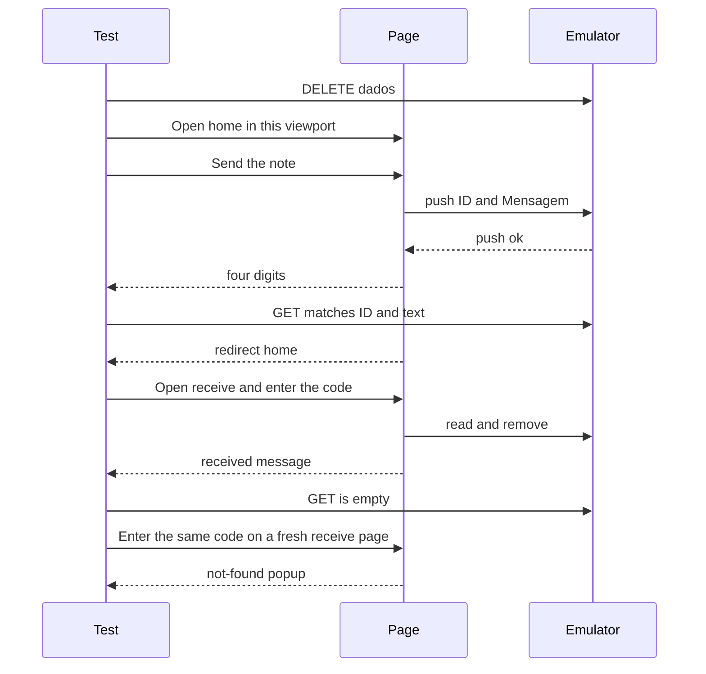

# Send and Receive End-to-End Tests - Plan

## Goal Capsule

- **Objective:** On the local site, a note can be checked once: it is stored, it can be read, and it is gone after that read, on a landscape screen and on a portrait screen.
- **Means:** Playwright on the host, against the Docker site and the Realtime Database emulator (KTD1).
- **Authority:** Requirements win on product behavior. Key technical decisions win on how the suite is built.
- **Execution profile:** code
- **Stop conditions:** Leave storage, code collision, the mobile send redirect, the mobile receive popup sentence, and the Firebase JS 8.10.1 client unchanged. Do not add CI.
- **Tail ownership:** Whoever runs the suite locally after Docker Compose is up.

---

## Product Contract

### Summary

This plan covers send and receive on the local site and emulator, locating screens by the test ids from issue 2, in landscape and in portrait. It adds those attributes on the existing pages and on the nodes created after send and receive, and it documents the command that runs the suite. Storage, code collision, and the mobile send redirect stay as they are.

### Problem Frame

The site has no tests. Send and receive cross separate HTML pages and Firebase, so the only check today is a person at the keyboard.

A code works once. The first frame shows neither the code nor the message. The code appears when the write finishes, while the raven is still moving. The received message appears only after the read has found the note and the raven reaches the right side.

### Key Decisions

- **Playwright drives the real pages in landscape and portrait.** (session-settled: user-approved — chosen over another browser runner: the suite has to open the real pages) Governs R7, R8, R9.
- **The suite runs locally. Continuous integration stays out.** (session-settled: user-approved — chosen over a CI workflow: issue 2 asks for a documented local command) Governs R8.
- **The mobile receive popup keeps its current sentence. The suite checks that the popup appears.** (session-settled: user-approved — chosen over fixing that sentence: the copy change is outside issue 2) Governs R6.

### Requirements

**Screen marks**

- R1. Desktop and mobile pages expose the same `data-testid` values, and the existing ids stay.

| `data-testid` | Where |
| --- | --- |
| `send-link` | Home, the send link |
| `receive-link` | Home, the receive link |
| `message-input` | Scroll textarea on send |
| `send-button` | The control that calls `verificarEnv()` |
| `empty-popup` | Empty-scroll popup (`#frente` on send) |
| `popup-backdrop` | Overlay that closes the popup (`#fundo`) |
| `receive-code` | Code input (`#i0`) |
| `not-found-popup` | Missing-code popup (`#frente` on receive) |

- R2. `code-digit` is on each of the four digit nodes created after send, and `received-message` is on the readonly textarea created after a successful receive.

**Flows the suite proves**

- R3. An empty scroll opens `empty-popup` and leaves `dados` empty.
- R4. Sending text shows four `code-digit` values and stores `{ ID, Mensagem }` under `dados`, with `ID` equal to those digits in DOM order.
- R5. Entering that code shows `received-message` with the same text and removes the record from `dados`.
- R6. A code that was already read, and a code that does not exist, both open `not-found-popup`.
- R7. Landscape exercises the desktop pages, and portrait exercises the mobile pages, through the existing orientation redirect.

**Local run**

- R8. After Compose is up, the README states that dependencies and the browser are installed, and then the suite runs against the local site and emulator.
- R9. The suite talks only to the local emulator, on a loopback host.

### Key Flows

- F1. Landscape journey
  - **Trigger:** A test starts with `dados` empty and a landscape viewport.
  - **Steps:** Home, activate `send-link` for an empty scroll and confirm `empty-popup` and `popup-backdrop` while `dados` is still empty, activate `send-link` again, send text, capture the code, confirm the record, then activate `receive-link`, confirm deletion, open receive again for the same code, then open receive again and try `0000` on an empty `dados`. The pathname matches that page after each home link (KTD6).
  - **Outcome:** R3, R4, R5, and R6 hold on `index.html`, `enviar.html`, and `receber.html`.
  - **Covered by:** R3, R4, R5, R6, R7
- F2. Portrait journey
  - **Trigger:** A separate test starts with `dados` empty and a portrait viewport.
  - **Steps:** The same sequence as F1, on the mobile pages. After send, the portrait home finishes on `index-mobile.html`.
  - **Outcome:** R3, R4, R5, and R6 hold on `index-mobile.html`, `enviar-mobile.html`, and `receber-mobile.html`.
  - **Covered by:** R3, R4, R5, R6, R7

### Acceptance Examples

- AE1. Empty scroll
  - **Covers:** R3
  - **Given:** The send page and an empty textarea.
  - **When:** The sender activates `send-button`.
  - **Then:** `empty-popup` and `popup-backdrop` become visible, and `dados` stays empty.
- AE2. Send with text
  - **Covers:** R4
  - **Given:** The send page and the text `hello raven`.
  - **When:** The sender activates `send-button`.
  - **Then:** Four `code-digit` nodes each show one digit, and `dados` has one child whose `ID` is those digits in order and whose `Mensagem` is `hello raven`.
- AE3. Read once
  - **Covers:** R5
  - **Given:** The record from AE2.
  - **When:** The receiver enters those four digits in `receive-code`.
  - **Then:** `received-message` shows `hello raven` and is readonly, and `dados` is empty.
- AE4. Read again
  - **Covers:** R6
  - **Given:** AE3 already removed the record.
  - **When:** The receiver opens the receive page again and enters the same code.
  - **Then:** `not-found-popup` becomes visible.
- AE5. Unknown code
  - **Covers:** R6
  - **Given:** `dados` is empty and the receive page was just opened.
  - **When:** The receiver enters `0000` on that fresh page.
  - **Then:** `not-found-popup` becomes visible, and `received-message` is absent.

### Scope Boundaries

- Storage stays the folder `dados` and the fields `ID` and `Mensagem`. No collision check.
- The mobile send redirect stays `index.html`. Portrait then follows the home orientation script to `index-mobile.html`.
- No CI workflow.
- The mobile receive popup sentence stays as it is. Acceptance is visibility of `not-found-popup`.
- A spaces-only scroll, a partial code, and a click on `popup-backdrop` are outside this suite.
- The Firebase JS client stays the 8.10.1 CDN build. No modular migration.
- Playwright does not start Docker. The suite assumes Compose is already up.

---

## Planning Contract

### Key Technical Decisions

- KTD1. Pin `@playwright/test` at 1.64.1 and set `baseURL` to `http://127.0.0.1:8080`. (session-settled: user-approved — chosen over another browser runner: the suite has to open the real pages) Every navigation stays on that origin. Before send and before the receive `fill`, fail if `location.hostname` is not `127.0.0.1`, and abort any request whose host is `firebaseio.com`. The page enables the emulator only for `localhost` and `127.0.0.1`, inside a `try/catch` that swallows failure. A later emulator `GET` does not undo a production write. Governs R7, R8, R9.
- KTD2. Run with `workers: 1` and leave `fullyParallel` off. Receive deletes every matching `ID`, and two tests would share one `dados` tree. Do not use serial mode in place of a single worker.
- KTD3. Reset and read the emulator only at the literal URL `http://127.0.0.1:9000/dados.json?ns=raven-traveler`. Do not build that URL from `firebaseConfig` or `databaseURL`. `DELETE` runs at the start of each test and again in `afterEach`, on success and on failure. Do not `DELETE` between send and receive (KTD5). `GET` proves the write and the delete. A `DELETE` that does not succeed stops the test before send. Treat `ID` as a four-character string. A missing `ns` reads a different namespace. New harness files do not contain the client key or the production database URL.
- KTD4. Copy the four digit texts out of the page inside a poll whose interval is shorter than one send frame (100 ms), then let the redirect happen. Give the `received-message` assertion and the post-send pathname assertion 15 seconds. The redirect lands about 8.3 seconds after send in landscape and about 8.7 seconds in portrait. Do not wait for network idle. Abort `wurfl.io` and `fonts.googleapis.com`. Leave the Firebase CDN scripts on `gstatic.com` alone.
- KTD5. F1 and F2 each send their own note. Do not reuse one record across layouts, and do not `DELETE` between send and receive. The unknown code is `0000` on empty `dados`, entered on a receive page opened for that step. The previous miss leaves the code field read-only. Do not click `popup-backdrop` on the not-found popup. That click navigates to `receber.html`. Do not click the home link send inserts before the push. The landing home is the timer redirect in `enviar()`.
- KTD6. Set the viewport before navigation, as two projects or two `test.use` blocks. Landscape is 1280×720. Portrait is 390×844. Do not resize after load. The pages do not listen for resize. Shared `data-testid` values do not prove the layout. Before each action, the pathname is the desktop file or the mobile file for that journey. After a portrait send, the pathname is `index-mobile.html`. The two layouts share the single worker in KTD2.

### High-Level Technical Design



The digits are painted when the push resolves, while the raven is still moving. The page leaves for home on the tick that reaches the left edge after that resolve. The receive textarea is created only when the query has found the note and the raven reaches the right side. The not-found popup opens when the query finishes.

### Output Structure

```
package.json
package-lock.json
playwright.config.js
e2e/emulator.js
e2e/send-receive.spec.js
```

U1 edits the six HTML pages and `js/script.js`. U2 edits `README.md` and `.gitignore` and adds the root harness files. U3 adds `e2e/`.

### Risks

- A page whose hostname is not `127.0.0.1` writes production, and the emulator `GET` does not remove that note. KTD1 fails the test before send and aborts `firebaseio.com`.
- A `DELETE` only at the start leaves the note in the emulator when a test fails after the push. The `afterEach` in KTD3 clears it. The single worker in KTD2 keeps that cleanup from deleting another test's note.
- A new harness file that copies `firebaseConfig` can `DELETE` the production tree. KTD3 keeps the emulator URL literal and keeps the client key out of those files.
- The default expect timeout is 5000 ms. One receive flight is about 5.3 s, and the send redirect is about 8.3 s in landscape and 8.7 s in portrait. KTD4 sets 15 s on `received-message` and on the post-send pathname check.
- If the push resolves on the last send tick, the digits exist for under 100 ms. The poll in KTD4 copies them before the redirect.
- `wurfl.io` and the Google fonts stylesheet block `load`. KTD4 aborts those routes and leaves the Firebase scripts in place.
- Compose has no healthcheck. A down emulator fails the opening `DELETE` in KTD3. The suite does not start Docker itself.

### System-Wide Impact

- The six pages share `js/script.js`. U1 adds test ids inside `enviar()` and `recInputCod()`, and on the markup in R1. No new top-level statement in that file. The home pages load it without the Firebase SDK.
- GitHub Pages and the nginx container both serve the repo root. The new root files are not product UI. The suite origin is KTD1, not the public site URLs already listed in `README.md`.
- Landscape and portrait are chosen before load (KTD6). Send inserts a home link before the push. The suite does not use that link (KTD5).

### Sources

- Issue 2: https://github.com/lukec3x/Traveling-Raven/issues/2
- Playwright timeouts, locators, and parallelism: https://playwright.dev/docs/test-timeouts and https://playwright.dev/docs/test-parallel
- Emulator REST and `ns`: https://firebase.google.com/docs/emulator-suite/connect_rtdb
- Namespaced `useEmulator` on the 8.x client, still published, no sunset: https://firebase.google.com/docs/reference/js/v8/firebase.database.Database#useemulator
- Local wiring: `js/script.js`, `compose.yaml`, `Dockerfile.firebase`, `database.rules.json`

---

## Implementation Units

### U1. Mark the screens

- **Goal:** Expose R1 and R2 without changing behavior.
- **Requirements:** R1, R2
- **Dependencies:** none
- **Files:** `index.html`, `index-mobile.html`, `enviar.html`, `enviar-mobile.html`, `receber.html`, `receber-mobile.html`, `js/script.js`
- **Approach:**
  - Put each static test id from R1 on the element named in that table, on both pages of the pair.
  - Put `code-digit` on the four digit nodes `enviar()` creates, and `received-message` on the textarea `recInputCod()` creates.
  - Leave existing ids, field names, frame counts, and redirects unchanged. Add no top-level statement in `js/script.js`.
- **Patterns to follow:** One shared `js/script.js`. The same test id value on the desktop and mobile markup.
- **Test scenarios:** Test expectation: none. These attributes are exercised by U3.
- **Verification:** Each id in R1 and R2 is present on both layouts, and the existing ids are still there.

### U2. Add the Playwright harness

- **Goal:** Give the repo a local Playwright project that can only target the loopback site.
- **Requirements:** R8, R9
- **Dependencies:** none
- **Files:** `package.json`, `package-lock.json`, `playwright.config.js`, `.gitignore`, `README.md`
- **Approach:**
  - Add `@playwright/test` at the version in KTD1. Commit the lockfile.
  - Apply the config-shaped part of KTD1 (version pin and `baseURL`), plus KTD2 and KTD6. The hostname check and the production-host abort live in U3. Ignore `node_modules`, `test-results`, `playwright-report`, and `blob-report`.
  - Document in the local section of `README.md` that Compose comes up first, then dependencies and Chromium are installed, then the suite runs. Do not copy `firebaseConfig` into the README.
- **Execution note:** This is packaging. A config load is enough here. The behavioral proof is U3.
- **Patterns to follow:** `README.md` already documents `docker compose up --build` and `http://localhost:8080`.
- **Test scenarios:** Test expectation: none. Scaffolding only.
- **Verification:** The config pins the KTD1 version, one worker, and `baseURL` `http://127.0.0.1:8080`. The README names the install steps and the suite command next to the existing local-run steps.

### U3. Cover send and receive in both orientations

- **Goal:** Prove F1 and F2 against the emulator.
- **Requirements:** R3, R4, R5, R6, R7, R9. Proves F1 and F2.
- **Dependencies:** U1, U2
- **Files:** `e2e/send-receive.spec.js`, `e2e/emulator.js`
- **Approach:**
  - Follow KTD3, KTD4, KTD5, and KTD6. Before send and before the receive `fill`, fail if `location.hostname` is not `127.0.0.1`, and abort any request whose host is `firebaseio.com` (KTD1). Enter the code with `fill` of the four characters and no extra digit.
  - Open home first. Activate `send-link` before each send case and `receive-link` before each receive case. Check the pathname after each link (KTD6).
  - Keep product code unchanged. Frame counts stay 100 on send and 60 on receive.
- **Execution note:** Prove the current send and receive behavior on the running emulator. Add a test id only if U1 missed one. Do not shorten the animation or change the redirect to make the suite faster.
- **Patterns to follow:** `verificarEnv()` treats only `''` as empty. `veriCod()` searches when the digits, ignoring spaces, reach length 4. `recInputCod()` sets the textarea with `innerText` and `readOnly`.
- **Test scenarios:**
  - Covers AE1. Landscape, from home activate `send-link`, leave the textarea empty, activate `send-button`: `empty-popup` and `popup-backdrop` become visible, and the emulator `GET` is null.
  - Covers AE2. Landscape, from home activate `send-link`, enter `hello raven`, activate `send-button` without clicking the in-page home link: four `code-digit` nodes each have one digit, the emulator child has that `ID` string and `Mensagem` `hello raven`, and the timer redirect finishes on `index.html`.
  - Covers AE3. Landscape, from home activate `receive-link`, then `fill` those four digits into `receive-code`: `received-message` shows `hello raven` and is readonly, within the KTD4 timeout, and the following `GET` is null.
  - Covers AE4. Landscape, open receive again and `fill` the same code: `not-found-popup` becomes visible, and the backdrop is not clicked.
  - Covers AE5. Landscape, open a fresh receive page with empty `dados` and `fill` `0000`: `not-found-popup` becomes visible, and `received-message` is absent.
  - Portrait repeats AE1 through AE5, entering through the mobile home links. After send, the pathname finishes on `index-mobile.html`. Receive uses `receber-mobile.html`. The pathname is the mobile file before each action (KTD6).
  - One send stubs the random source so the first digit is `0`, then receive matches that code. The stored `ID` is the four-character string. The product generator stays unchanged.
  - The four `code-digit` nodes can be empty on the first frame. The case passes only after each has one digit.
  - Digits on screen with no matching emulator child fail the send case.
  - F1 does not `DELETE` between its send and its receive. F2 sends a new note. It does not read the F1 record.
- **Verification:** Both orientations pass the scenarios above while Compose is up. A second receive of the same code shows `not-found-popup`. The mobile popup sentence is not asserted.

---

## Verification Contract

Compose is already up (`docker compose up --build` in `README.md`). From the repo root, `npm ci`, then `npx playwright install chromium`, then `npx playwright test` is the gate. It must pass on the landscape viewport and the portrait viewport. There is no CI job in this plan.

The gate is green only when the emulator `GET` matches the screen for send and is empty after a successful receive. A visible code alone does not pass R4. The suite fails before send when the page host is not `127.0.0.1` (KTD1).

---

## Definition of Done

- U1, U2, and U3 meet their verification.
- R1 through R9 hold.
- `npx playwright test` passes against the local emulator.
- The diff does not change frame counts, the mobile send redirect, the mobile receive popup sentence, or the Firebase client.
- Abandoned experiment code is not left in the diff.
- `README.md` documents the suite command beside the existing local-run steps.
